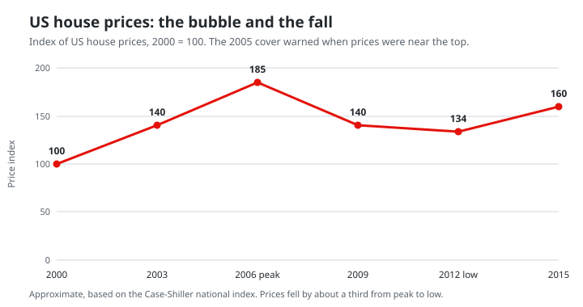

# 2005

[Back to the full index](../README.md)

2005 holds the single best prediction in this whole project: a calm, clear warning, three years early, that the world housing bubble would pop. Read it first if you read only one page.

---

## "After the fall": June 18, 2005

**What the cover shows:** A painting of a single house brick falling from a great height towards the ground. Written on the brick are the words "house prices".

**The picture, piece by piece:**
- A single brick, not a whole house: one brick stands for the entire housing market, and bricks are also what houses are built from.
- The brick falling from a great height: the higher prices had climbed, the harder the landing would be, which is the whole warning.
- The words "house prices" written on the brick: there is no riddle to solve, the magazine spells out exactly what is going to fall.
- The empty space around it: nothing and nobody is there to catch the brick, just as nothing could catch the market.

**What was happening:** House prices had risen hugely around the world. The value of homes in rich countries had grown by more than 30 trillion dollars in five years, and buying and selling houses had become a mania in America, Britain, Spain, and Australia.

**The point it made:** The magazine said plainly: "The worldwide rise in house prices is the biggest bubble in history. Prepare for the economic pain when it pops." It added that prices would fall slowly, like a brick with a parachute, but the landing would still hurt.

**Verdict: Came true.** American house prices peaked in 2006 and then fell by about 32 percent across the country, wiping out nearly 7 trillion dollars of home wealth. The crash helped cause the world financial crisis of 2008. This is probably the most valuable warning the magazine ever printed on a cover.

**What happened next:**
- 2006: American house prices peaked and began to fall.
- 2007: falling house prices froze lending between banks and started the credit crunch.
- September 2008: the bank Lehman Brothers collapsed, and the crisis spread across the whole world.
- 2008 to 2009: governments spent huge sums rescuing banks, while millions of people lost their homes and jobs.

*Sources: [NBER working paper](https://live-nber.pantheonsite.io/system/files/working_papers/w18400/revisions/w18400.rev0.pdf), [Wikipedia: 2000s United States housing bubble](https://en.wikipedia.org/wiki/2000s_United_States_housing_bubble), [The cover story itself, FCIC archive (PDF)](http://fcic-static.law.stanford.edu/cdn_media/fcic-docs/2005-06-18%20After%20the%20Fall%20(The%20Economist).pdf)*

---

## "The oiloholics": August 27, 2005

**What the cover shows:** A cartoon of a very fat Uncle Sam and a red Chinese dragon with the word "CHINA" on it. Both lie back on a pile of oil barrels, each happily sipping oil from a barrel through a straw, like drunks who cannot stop drinking.

**The picture, piece by piece:**
- The very fat Uncle Sam: the cartoon figure who always stands for America, here grown fat and lazy on cheap oil.
- The red Chinese dragon: China drawn as a dragon, and just as drunk on the same habit as America.
- The pile of oil barrels used as a sofa: both countries are shown resting on oil itself, as if their comfort rests on it.
- The straws in the barrels: sipping oil like a soft drink makes the addiction look greedy and childish.
- The made up word "oiloholics": it copies the word "alcoholics" to say that oil, for these two countries, is a drink problem.

**What was happening:** Oil prices had more than tripled since late 2001 and had gone above 67 dollars a barrel. America used more oil than any other country, and China's thirst for oil was growing faster than anyone else's.

**The point it made:** The magazine said the two biggest oil users were addicted to oil, and warned: "Oil prices could yet go higher, unless the world's biggest gas guzzlers curb their thirst."

**Verdict: Partly true.** Prices did go much higher, reaching about 147 dollars a barrel in July 2008, before crashing in the financial crisis. America and China also stayed the world's two biggest oil users for many years afterwards.

**What happened next:**
- July 2008: the oil price reached about 147 dollars a barrel, its highest level ever.
- Late 2008: the financial crisis cut demand, and the oil price crashed.
- 2010s: America drilled much more of its own oil from shale rock, while China became the world's biggest buyer of foreign oil.
- 2020s: electric cars began, slowly, to loosen the addiction this cover had mocked.

*Source: [Instagram archive post](https://www.instagram.com/p/DdoVg7WI1tx/)*
