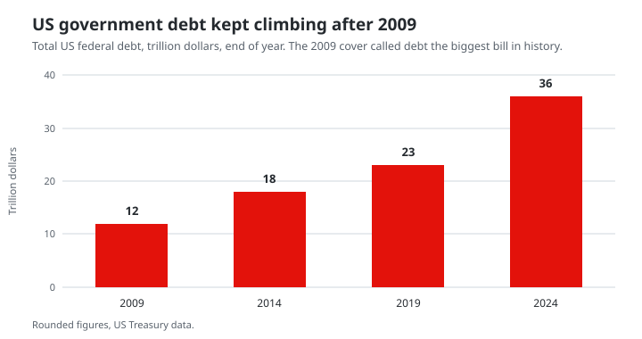

# 2009

[Back to the full index](../README.md)

In 2009 the world was counting the cost of the crash: a new flu scare, mountains of government debt, and one of the most famous covers the magazine ever made, about Brazil.

## At a glance

| Cover | Date | Theme | The call | Status |
|---|---|---|---|---|
| The pandemic threat | May 2, 2009 | Health and society | A new flu could spread around the world as a pandemic | 🟡 PARTLY HAPPENED |
| Debt: the biggest bill in history |  | Money and markets | Crisis debt would land on children and grandchildren | ✅ HAPPENED |
| Brazil takes off | November 12, 2009 | Money and markets | Brazil's moment as a serious world power had arrived | 🟡 PARTLY HAPPENED |

---

## "The pandemic threat": May 2, 2009

**Cover line:** "The pandemic threat", with the subline "How scared should you be?"

**What the cover shows:** The Grim Reaper, the figure of Death in a black hooded robe, wearing a light blue surgical face mask. He carries his big scythe over one shoulder and is reading a book called "Atlas of the World", as if planning where to travel next.

**The picture, piece by piece:**
- The Grim Reaper: Death itself, the oldest symbol of plague and mass dying.
- The light blue surgical mask: a modern hospital detail on an ancient figure, an old fear in a new form.
- The scythe over his shoulder: his usual tool, carried casually, as if death is just doing its rounds.
- The book, "Atlas of the World": he is planning his route, a dark joke about how fast a virus can now travel the globe.

**What was happening:** A new swine flu virus, called H1N1, had broken out in Mexico and the United States and was spreading between countries. People feared a repeat of the 1918 flu, which killed tens of millions.

**The point it made:** A new flu could spread around the whole world fast, and governments needed to be ready. The magazine asked how scared people should really be.

**Verdict: Partly true.** The World Health Organization did declare a swine flu pandemic in June 2009, so the threat was real. But the disease turned out much milder than feared, and the truly huge pandemic only arrived in 2020 with COVID-19.

**What happened next:**
- June 2009: the World Health Organization declared swine flu a pandemic.
- 2009 to 2010: the virus spread around the world but proved much milder than feared.
- After 2010: the H1N1 virus settled down and became one of the regular seasonal flu viruses.
- 2020: the truly huge pandemic arrived with COVID-19, eleven years after this warning.

*Source: [Facebook post by Jose Luis Navarro Laya](https://www.facebook.com/joseluis.navarrolaya/posts/pfbid02njabGSR6Jkw274nZFrg7eAaA2DHpZdncGRHvepwCdJ1PuTyvj1TzrxeQTnM7rAHGl)*

---

## "Debt: The biggest bill in history": June 13, 2009

**What the cover shows:** A small naked baby crawling on the floor, chained to an enormous dark ball, like a prisoner in an old cartoon. The ball is government debt, and the baby stands for the future generations who will have to carry it.

**The picture, piece by piece:**
- The naked baby: a newborn stands for the next generation, innocent and too young to speak for itself.
- The enormous dark ball: government debt drawn as a crushing weight, far bigger than the child.
- The chain: the baby never chose this burden and cannot escape it. It is locked on from birth.
- The old cartoon prisoner style: a ball and chain means prison, so future taxpayers are shown as trapped.

**What was happening:** Governments had borrowed huge sums of money to rescue banks and to fight the recession. Rich country debt was rising faster than at any time since the Second World War.

**The point it made:** The rescue bills would land on children and grandchildren. Paying for the crisis would shape politics and taxes for decades.

**Verdict: Came true.** Rich world government debt kept climbing after 2009, passing 100 percent of GDP in the United States and far more in Japan. Fights over debt and borrowing have stayed at the centre of politics ever since.

**What happened next:**
- After 2009: rich country government debt kept climbing instead of falling back.
- 2010 to 2012: debt fears helped spark the euro area crisis, starting in Greece.
- In the following years: debt in the United States passed 100 percent of GDP, and Japan's rose far beyond that.
- Ever since: fights over borrowing and debt limits have stayed at the centre of politics.

*Sources: [Instagram archive post](https://www.instagram.com/p/DTnoLJjCB38/), [Instagram archive post](https://www.instagram.com/p/DbIwxUAgjPy/)*

---

## "Brazil takes off": November 12, 2009

**What the cover shows:** The famous statue of Christ the Redeemer above Rio de Janeiro blasting off into the sky like a rocket, leaving the Corcovado mountain behind. It is one of the most famous Economist covers of all time.

**The picture, piece by piece:**
- Christ the Redeemer: the most famous symbol of Rio de Janeiro, and of Brazil itself.
- The rocket takeoff: the statue blasts off like a space rocket, saying Brazil's rise would be fast and powerful.
- The mountain left behind: Brazil is shown escaping its old place and its old limits.
- The proud, happy mood: there is no warning anywhere in the picture, only celebration. That is why the later fall hurt so much.

**What was happening:** Brazil had come through the financial crisis in good shape, its economy was booming on high prices for oil, iron and food, and it had just won the right to host the 2016 Olympics. President Lula was popular around the world.

**The point it made:** Brazil was becoming a serious world power at last. Its moment of takeoff had arrived.

**Verdict: Partly true.** Brazil grew fast in 2010 and hosted the World Cup and Olympics, but then it fell into a deep recession in 2015 and 2016 and a huge corruption scandal. The cover later became a famous example of the "magazine cover curse", where a cover story marks the top of a boom. The magazine made fun of its own cover four years later; see ["Has Brazil blown it?"](2013.md) in 2013.

**What happened next:**
- 2010: Brazil's economy grew fast, and President Lula left office very popular.
- 2014: Brazil hosted the football World Cup, though many people protested about its cost.
- 2015 to 2016: Brazil fell into a deep recession, and a huge corruption scandal around the state oil firm Petrobras shook the country.
- 2016: Rio hosted the Olympic Games while President Dilma Rousseff was removed from office.

*Sources: [Bank of England speech](https://www.bankofengland.co.uk/-/media/boe/files/speech/2015/growing-your-business-in-the-global-economy-not-all-doom-and-gloom.pdf), [Everand: Brazil, The Troubled Rise of a Global Power](https://www.everand.com/book/1079595863/Brazil-The-Troubled-Rise-of-a-Global-Power)*
