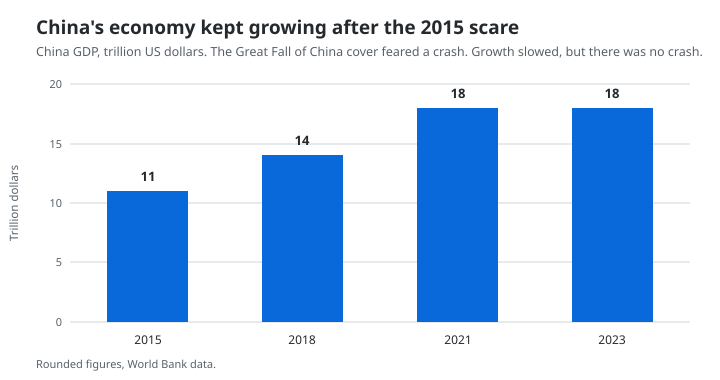

# 2015

[Back to the full index](../README.md)

2015 brought a market crash in China and a refugee crisis in Europe. One cover from this year is now taught as a famous wrong call. The other picked the leader who would hold Europe together for six more years.

## At a glance

| Cover | Date | The call | Status |
|---|---|---|---|
| The Great Fall of China | Aug 29, 2015 | China's economy was in deep trouble and fear could spread worldwide | 🟡 PARTLY HAPPENED |
| The indispensable European | Nov 7, 2015 | Only Merkel had the strength to lead Europe (a judgment) | ⚪ NOT A PREDICTION |

---

## "The Great Fall of China": August 29, 2015

**What the cover shows:** The picture plays on the Great Wall of China. The famous wall is shown breaking and crumbling, like something strong that is falling apart. It is a picture of China and its money power falling down.

**The picture, piece by piece:**
- The Great Wall: China's most famous symbol of strength, so a cracking wall means a strong country is cracking.
- The crumbling bricks: the damage is spread along the wall, not in one hole, which matches a whole economy in trouble.
- The title is a wordplay: "the great fall" means both a fall in prices and a great power falling down.
- The wall built to protect China: the joke is that the thing meant to keep China safe now looks like the thing that is failing.

**What was happening:** In the summer of 2015, China's stock market crashed. Share prices fell more than 40 percent from their June peak, China suddenly lowered the value of its money, the yuan, and about 5 trillion dollars was wiped off world markets. On August 24, called "Black Monday", Chinese shares had their biggest one day fall since 2007.

**The point it made:** The magazine said China was not in a full crisis, but its economy was in deep trouble, and the fear could spread to poorer countries and to the whole world.

**Verdict: Partly true.** World markets did keep falling into early 2016, and China's growth did slow down over the next ten years. But the big crash and world crisis never came. China's economy kept growing at about 6 to 7 percent a year, and its GDP rose from about 11 trillion dollars in 2015 to about 19 trillion by 2023. This cover is now often used as an example of a famous wrong call.

**What happened next:**
- August 24, 2015: "Black Monday", when Chinese shares had their biggest one day fall since 2007.
- Early 2016: world markets kept falling as fear about China spread.
- 2015 to 2023: China's GDP still grew from about 11 trillion dollars to about 19 trillion, so the great fall never came.

*Sources: [VPAM](https://www.vpam.com/post/the-great-fall-of-china), [Crossbridge Capital](https://crossbridgecapital.com/china-ailing-or-evolving/)*

---

## "The indispensable European": November 7, 2015

**What the cover shows:** A large portrait photograph of German leader Angela Merkel fills the cover. She looks calm and serious. No other leader is shown, which makes the point that she stands alone at the top of Europe.

**The picture, piece by piece:**
- Merkel's face fills the whole cover: she is not one leader among many, she is the whole story.
- Her calm and serious look: the picture sells steadiness in a crisis, not excitement or drama.
- No other leader appears: the empty space around her says Europe had nobody else to turn to.
- A photograph instead of a cartoon: using a real photo makes the praise feel serious and factual.

**What was happening:** Europe was in the middle of the refugee crisis. About a million people, many fleeing the war in Syria, came to Europe in 2015, and Merkel had opened Germany's doors to them. Greece had also nearly crashed out of the euro that summer, and Merkel was the leader holding Europe together.

**The point it made:** The magazine said that of all Europe's leaders, only Merkel had the strength and the values to lead the continent, above all on refugees.

**Verdict: Not a prediction.** It was a judgment, and the judgment mostly held up. Merkel stayed as Germany's leader until December 2021, sixteen years in total, and she remained Europe's central figure through Brexit and the Trump years. Her refugee decision stayed unpopular with many voters and helped a new anti-migration party, the AfD, grow in Germany.

**What happened next:**
- 2015: about a million people reached Europe in the refugee crisis, and Merkel opened Germany's doors to them.
- 2016: Britain voted to leave the EU, and Merkel became the main voice defending the union.
- December 2021: Merkel left office after sixteen years as Germany's leader.

*Sources: [Carnegie Endowment](https://carnegieendowment.org/europe/strategic-europe/2015/11/europes-problem-with-vision), [Quadrant](https://quadrant.org.au/magazine/2022/01/the-dispensable-mrs-merkel/)*
