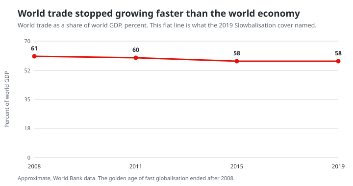

# 2019

[Back to the full index](../README.md)

2019 gave the world a new word, "slowbalisation", watched young voters flirt with socialism, and saw Hong Kong rise up against Beijing. The Hong Kong warnings proved painfully accurate.

## At a glance

| Cover | Date | Theme | The call | Status |
|---|---|---|---|---|
| Slowbalisation | January 26, 2019 | Trade and globalisation | The golden age of fast globalisation was over | ✅ HAPPENED |
| The rise of millennial socialism | February 16, 2019 | Politics and leaders | Socialism was back in fashion among the young | 🟡 PARTLY HAPPENED |
| The rule of law in Hong Kong | June 15, 2019 | China and Asia | A new law would destroy Hong Kong's rule of law | ✅ HAPPENED |
| Hong Kong in revolt | November 23, 2019 | China and Asia | The revolt was about Hong Kong's whole future under China (a report) | ⚪ NOT A PREDICTION |

---

## "Slowbalisation": January 26, 2019

**Cover line:** "Slowbalisation", with the subheading "The future of global commerce".

**What the cover shows:** A big snail crawls across the cover. Instead of a normal shell, the snail carries the planet Earth on its back. The joke is simple: world trade now moves at the speed of a snail.

**The picture, piece by piece:**
- The snail: one of the slowest animals stands for world trade slowing down.
- The Earth as its shell: the snail carries the whole planet, so the slowdown is global.
- A shell it cannot put down: the snail must drag its world with it, just as countries cannot escape slow trade.
- The invented word "slowbalisation": the magazine coined a name for the new era, and the name stuck.

**What was happening:** World trade and investment between countries had stopped growing fast after the 2008 financial crisis. Trade was about 61 percent of world GDP in 2008 and had slipped to about 58 percent. America and China were in a trade war, and support for open trade was falling.

**The point it made:** The magazine gave the new era a name. It said the golden age of fast globalisation, roughly 1990 to 2010, was over, and a slower, more regional world was taking its place, which would be meaner and less stable.

**Verdict: Came true.** Trade stayed flat as a share of world output, the US and China trade war continued, and after COVID many governments pushed production closer to home or to friendly countries. The word "slowbalisation" itself entered the Collins Dictionary, and writers still use the cover as the moment the idea was named.

**What happened next:**
- 2019: the America and China trade war continued, with tariffs on both sides.
- 2020: COVID hit world trade and supply chains even harder.
- After 2020: many governments pushed factories closer to home or into friendly countries.

*Sources: [YSU journal article](https://journals.ysu.am/index.php/arm-fol-angl/article/download/vol19_no1_2023_pp083-094/pdf/19663), [Cahiers du CEDIMES](https://cahiers.cedimes.com/wp-content/uploads/2025/02/03.2022-01_Cahiers_du_CEDIMES_CIACCIA.pdf)*

---

## "The rise of millennial socialism": February 16, 2019

**What the cover shows:** The artwork copies a famous 1924 Soviet poster by Alexander Rodchenko. A young woman shouts with her hand to her mouth, and the word "SOCIALISM" blasts out of her mouth in big red letters, like sound from a loudspeaker, on a red background.

**The picture, piece by piece:**
- The copied 1924 Soviet poster: using real communist art says this is an old idea returning, not a new one.
- The shouting young woman: the voice of the movement belongs to the young, not to old party leaders.
- The word SOCIALISM blasting out of her mouth: the idea itself works like a loudspeaker, too loud to ignore.
- The red background: red is the historic colour of socialism, and it makes the cover impossible to miss.

**What was happening:** Thirty years after the Berlin Wall fell, polls showed young people in America and Britain turning toward socialist ideas. A Gallup poll found 51 percent of Americans aged 18 to 29 viewed socialism positively. Bernie Sanders in America and Jeremy Corbyn in Britain were popular with the young.

**The point it made:** The magazine said socialism was back in fashion among the young because capitalism had failed them on housing, student debt and low pay, and it warned readers to take the new ideas seriously, even where it disagreed with them.

**Verdict: Partly true.** The ideas stayed strong. Sanders ran a powerful campaign for the US presidency in 2020, and policies like higher taxes on the rich and public health care stayed popular with young voters. But no socialist took power: Sanders lost, and Corbyn's Labour Party lost the British election of December 2019 very badly.

**What happened next:**
- December 2019: Corbyn's Labour Party lost the British election very badly.
- 2020: Bernie Sanders ran a powerful campaign for the US presidency but did not win.
- 2020s: ideas like higher taxes on the rich and public health care stayed popular with young voters.

*Sources: [MarkLives](https://www.marklives.com/2019/02/media-design-economist-ma-nyt-mag-ubisoft-stories-zigzag/), [Institute of Economic Affairs](https://iea.org.uk/democratic-socialism-still-a-mirage/)*

---

## "The rule of law in Hong Kong": June 15, 2019

**What the cover shows:** The cover is built around a pair of metal handcuffs, the sign of arrest and prison. The message is that Hong Kong, a free city, is being locked up. (The cover line above is the cover story title; the exact wording printed on the cover could not be confirmed from open sources.)

**The picture, piece by piece:**
- The metal handcuffs: they stand for arrest and prison, the tools of a police state.
- Handcuffs as the whole picture: there is no crowd and no flag, just the threat of being locked up.
- The cold, plain metal: it feels hard and final, like a door closing on a free city.

**What was happening:** Hong Kong's government wanted a new law that would let people be sent to mainland China to face trial there. About a million people marched against it on June 9, the biggest protest since China took Hong Kong back in 1997, and police used tear gas and rubber bullets on protesters days later.

**The point it made:** The magazine said Hong Kong's fair courts and rule of law were the city's most precious thing, and the new law would destroy them, because in China the Communist Party stands above the law.

**Verdict: Came true.** The extradition bill was withdrawn in the autumn of 2019, but in June 2020 Beijing forced a National Security Law on Hong Kong anyway. Since then many democracy activists and journalists have been jailed or have fled, and newspapers like Apple Daily have been shut down. Hong Kong's old freedoms are widely judged to be gone.

**What happened next:**
- June 9, 2019: about a million people marched against the extradition bill.
- Autumn 2019: the government withdrew the bill after months of protests.
- June 2020: Beijing imposed the National Security Law on Hong Kong anyway.
- 2021: the newspaper Apple Daily was shut down, and many activists were jailed or fled.

*Sources: [Milled newsletter archive](https://milled.com/the-economist-ie/people-v-power-the-rule-of-law-in-hong-kong-2z8OkEparZWf87QP), [Isidor's Fugue](https://www.isidorsfugue.com/search/label/Hong%20Kong?updated-max=2019-12-12T07:44:00-08:00&max-results=20&start=40&by-date=false)*

---

## "Hong Kong in revolt": November 23, 2019

**What the cover shows:** The cover uses protest imagery from the streets of Hong Kong, from the week when protesters were trapped inside a university campus, surrounded by police, after months of clashes with tear gas and petrol bombs. The cover story was subtitled "China's unruly periphery".

**The picture, piece by piece:**
- Real protest imagery instead of a cartoon: real scenes say this is no longer an argument, it is a street battle.
- The trapped university campus: students surrounded by police show how far the revolt had gone.
- The subtitle "China's unruly periphery": it frames Hong Kong as a rebellious edge of China, which is close to how Beijing itself saw the city.

**What was happening:** The protests that began in June had grown into a full revolt against Beijing's control. That week, police besieged Hong Kong Polytechnic University, where hundreds of protesters were trapped inside, while across the city protesters fought running battles with police.

**The point it made:** The magazine said the revolt was now about the whole future of Hong Kong under China, not just one law, and that Beijing's tightening grip was the root cause of the anger.

**Verdict: Not a prediction.** It was a report on events, but its warning about tighter control came true. The protests faded in early 2020 as COVID arrived, and in June 2020 Beijing imposed the National Security Law, which ended the protest movement and much of Hong Kong's free politics.

**What happened next:**
- November 2019: police besieged Hong Kong Polytechnic University, with hundreds of protesters trapped inside.
- Early 2020: the protests faded as COVID arrived.
- June 2020: Beijing imposed the National Security Law, which ended the protest movement.

*Source: [ASEAN Resource Centre](https://resourcecentre.asean.org/Magazine_Newspaper_Detail/?page=4&ID=266)*
