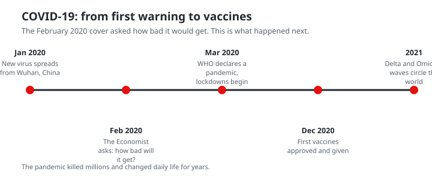

# 2020

[Back to the full index](../README.md)

2020 was the COVID year. The covers followed the virus from the first warning in February to lockdowns, broken economies, and the question of what disaster comes next. The very first virus cover got its warning exactly right.

## At a glance

| Cover | Date | Theme | The call | Status |
|---|---|---|---|---|
| How bad will it get? | February 1, 2020 | Health and society | The Wuhan virus could become a pandemic | ✅ HAPPENED |
| Everything's under control | March 28, 2020 | Politics and leaders | The crisis would make government much bigger, and some power would stay | 🟡 PARTLY HAPPENED |
| The 90% economy | May 2, 2020 | Money and markets | Economies would run at about 90 percent of normal for a long time | 🟡 PARTLY HAPPENED |
| The next catastrophe (and how to survive it) | June 27, 2020 | Health and society | The world should prepare properly for the next big disaster | 🟡 PARTLY HAPPENED |

---

## "How bad will it get?": February 1, 2020

**What the cover shows:** Planet Earth wearing a face mask. The mask is made from China's red flag, with its yellow stars on it. The picture linked the new virus directly to China, where it started. The cover story asked: "Will the Wuhan virus become a pandemic?"

**The picture, piece by piece:**
- The Earth itself is the patient: the whole planet, not one city, is shown as sick.
- The face mask is the sign of a disease outbreak, the same mask doctors and nurses wear.
- The mask is made from China's red flag, with its yellow stars: it points at China as the place where the virus began.
- The headline question, "How bad will it get?", admits that nobody yet knew the answer.

**What was happening:** A new coronavirus had appeared in the Chinese city of Wuhan in late 2019. It was spreading fast, China had locked down whole cities, and nobody knew how far it would go.

**The point it made:** The magazine warned that this local outbreak could turn into a pandemic, a disease that spreads all over the world.

**Verdict: Came true.** In March 2020 the World Health Organization declared COVID-19 a pandemic. The virus reached almost every country, shut down much of daily life, and killed millions of people.

**What happened next:**
- March 11, 2020: the World Health Organization declared COVID-19 a pandemic.
- Spring 2020: country after country ordered lockdowns, closed schools and shut borders.
- December 2020: the first COVID vaccines were approved and given to the public.
- 2021 and after: the virus kept spreading in new waves, and masks stayed part of daily life in much of the world.

*Sources: [Taiwan News](https://www.taiwannews.com.tw/news/3867824), [Instagram archive post](https://www.instagram.com/p/DcKK21kj9YE/)*

---

## "Everything's under control": March 28, 2020

**Cover line:** "Everything's under control", with the sub-line "Big government, liberty and the virus".

**What the cover shows:** A giant hand holds a very thin leash. On the end of the leash is a small man wearing a mask, who is walking a small dog that also wears a mask. The joke is that the citizen is now the pet, and the state holds the leash.

**The picture, piece by piece:**
- The giant hand is the state: huge, faceless and in total control.
- The very thin leash shows how tight that control is, with almost no room to move.
- The small masked man is the ordinary citizen, shrunk to the size of a pet.
- Even the little dog wears a mask: the joke is that the man thinks he is walking the dog, while he is the one being walked.

**What was happening:** Governments everywhere were ordering lockdowns. People had to stay home, shops and schools closed, and the state suddenly controlled daily life in a way not seen for generations.

**The point it made:** The crisis would make government much bigger and more powerful, and some of that power might never be given back.

**Verdict: Partly true.** Governments did spend trillions and control everyday life in 2020 and 2021, and state debt stayed much higher afterwards. But most lockdown powers and daily controls were given up once vaccines arrived.

**What happened next:**
- 2020: governments spent trillions supporting workers and businesses during lockdowns.
- 2021: vaccine rollouts let most countries lift lockdown rules step by step.
- 2022: most daily controls and emergency powers were dropped in much of the world.
- After the crisis: government debt stayed much higher than before the pandemic.

*Source: [Facebook post by Ronald Chang](https://www.facebook.com/ronald.chang.439886/posts/pfbid06esmkTPkSpU2SMw8uV25cvc5voJoaGeLVFQEQu1FrZxW5592MfrNNAtaiW7smC4ol)*

---

## "The 90% economy": May 2, 2020

**What the cover shows:** The cover is built around its big title words. (The headline, date and theme are verified from The Economist's own newsletter, but a detailed description of the artwork could not be confirmed from a reliable source, so this entry does not guess at it.)

**The picture, piece by piece:**
- The big title words are the picture: the number itself does the talking.
- 90 percent sounds close to normal, and that is the trap: it looks fine but is not fine.
- The missing 10 percent stands for the empty restaurants, grounded planes and half full hotels.
- A smaller economy is the point: even a small slice missing makes the whole system weaker and less fair.

**What was happening:** China had started to reopen after its lockdown, and life there was busy but not normal. Restaurants, flights and hotels were still far below normal levels, and the rest of the world was about to face the same problem.

**The point it made:** Even after lockdowns ended, economies would run at only about 90 percent of normal for a long time. That smaller economy would be weaker, less fair and more fragile.

**Verdict: Partly true.** The picture fitted 2020 and 2021 well: weak travel, empty offices and fear of new waves. But fast vaccines and huge government spending produced a stronger bounce in 2021 and 2022 than the cover feared, even if some scars, like remote work and empty city offices, did last.

**What happened next:**
- 2020: China reopened first, but travel, flights and hotels stayed far below normal.
- 2021: vaccines and big government spending brought a stronger bounce than the cover feared.
- 2021 and 2022: economies in rich countries grew fast again as spending returned.
- Long term: remote work and empty city offices stayed, just as the cover's scars idea suggested.

*Sources: [Milled newsletter archive](https://milled.com/the-economist-fr/the-90-economy-1KxZEVqHaOnxB_29), [Morning Brew](https://www.morningbrew.com/stories/2020/05/03/economist-lays-main-features-90-economy)*

---

## "The next catastrophe (and how to survive it)": June 27, 2020

**What the cover shows:** A family of three sits calmly on a sofa at home, and all of them wear gas masks. Even the cat wears a small mask. On the wall behind them hang pictures of disasters: a virus, a volcano, a meteor, a nuclear mushroom cloud and more, and a clock shows midnight.

**The picture, piece by piece:**
- The family sits calmly, as if planning for disaster is now normal home life.
- The gas masks, even the small one on the cat, show a threat you cannot see or escape.
- The pictures on the wall are a menu of disasters: virus, volcano, meteor and nuclear cloud.
- The clock at midnight copies the Doomsday Clock idea: the world sits moments from disaster.

**What was happening:** COVID-19 was still spreading around the world. The shock showed that most governments had been badly prepared for a disaster that experts had warned about for years.

**The point it made:** The world should use the COVID shock to prepare properly for the next big disaster, whether it is another pandemic, a climate shock or a cyber attack.

**Verdict: Partly true.** Since 2020 the world has faced record heat, big floods, major cyber attacks and a land war in Europe, and experts still say preparedness is weak. But no single new disaster on the same global scale as COVID-19 has happened yet.

**What happened next:**
- 2021: major cyber attacks hit pipelines and companies, one of the risks the cover named.
- February 2022: Russia's invasion of Ukraine brought a land war back to Europe.
- 2022 and 2023: record heat and big floods hit many countries.
- Through it all: experts kept warning that governments were still not ready for the next big shock.

*Source: [Facebook post by Aida Gomez](https://www.facebook.com/Aida.GomezP1/posts/pfbid0GQYexLzMgHG1shHHwcL3PbjVXGqdkjC8kZf9SkpbMtbnJ7dPWuf7SXsV1ymY6WsRl)*
