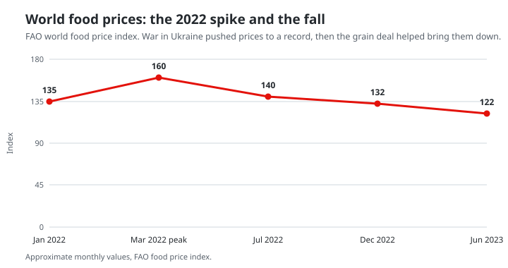

# 2022

[Back to the full index](../README.md)

2022 was dominated by one event: Russia's invasion of Ukraine. The magazine answered with one of the most powerful covers in its history, a cover with no words at all.

## At a glance

| Cover | Date | The call | Status |
|---|---|---|---|
| The wordless Ukraine flag cover | Mar 5, 2022 | No words and no forecast. A statement of horror and support | ⚪ NOT A PREDICTION |
| The alternative world order | Mar 19, 2022 | Russia and China were building an alternative world order | 🟡 PARTLY HAPPENED |
| The coming food catastrophe | May 21, 2022 | The war could push the world into a huge food crisis | 🟡 PARTLY HAPPENED |

---

## The wordless Ukraine flag cover: March 5, 2022

**Cover line:** None. The cover has no headline at all, which is very rare for this magazine.

**What the cover shows:** The top half of the cover is blue and the bottom half is yellow, the two colours of Ukraine's flag. Thick red blood drips down from the blue into the yellow. The illustration is by Andrea Ucini.

**The picture, piece by piece:**
- Blue on top and yellow below copy Ukraine's flag exactly, sky over wheat fields.
- The red blood dripping down turns a national flag into an open wound.
- There is no headline at all: the magazine decided words would weaken the message.
- The flat, plain design looks like a poster, not a magazine cover, so it could be shared like a sign.

**What was happening:** Russia had launched its full invasion of Ukraine on February 24, 2022. Russian forces were shelling Ukrainian cities and millions of people were fleeing their homes.

**The point it made:** With no words, the cover simply showed Ukraine bleeding. The article inside said that when Putin escalates his war, the world must stand up to him, and praised Ukraine's heroism and resilience.

**Verdict: Not a prediction.** It was a statement of horror and support, not a forecast. The war it mourned went on for years, with Ukraine still fighting, backed by Western weapons and money.

**What happened next:**
- February 24, 2022: Russia launched its full invasion of Ukraine.
- 2022: Western countries sent Ukraine weapons and money and placed sanctions on Russia.
- 2023 and after: the war ground on, with heavy losses on both sides.
- 2022 and after: this cover became one of the most shared magazine covers of the war.

*Sources: [Moneycontrol](http://www.moneycontrol.com/news/trends/current-affairs-trends/ukraine-russia-time-the-economist-cover-zelensky-moving-words-on-time-ukraine-flag-bleeds-on-the-economists-powerful-covers-8193161.html), [Facebook post by Jim Nesbitt](https://www.facebook.com/jim.nesbitt.92/posts/pfbid02Po5ePZzd6QQFRj9cBUpQkx7d8mhsdZz23NVSqhwtnxh685koQn2PoUaefzT3yCRel)*

---

## "The alternative world order": March 19, 2022

**Cover line:** "The alternative world order", with the line "Friendship between the two states has no limits".

**What the cover shows:** The faces of Vladimir Putin and Xi Jinping overlap each other. Putin's face is coloured blue and Xi's face is coloured red, and the two melt into one portrait. The cover was designed by Edmon de Haro.

**The picture, piece by piece:**
- Two faces melted into one portrait say the two leaders are becoming a single force.
- Putin in blue and Xi in red use cold, hard colours: there is no warmth in this partnership.
- The overlap hides where one face ends and the other begins, like their "no limits" promise.
- Neither man smiles: it is drawn as a partnership of power, not of friendship.

**What was happening:** Just before invading Ukraine, Putin had visited Beijing, and Russia and China had declared a friendship with "no limits". During the war, China refused to condemn Russia and kept trading with it.

**The point it made:** The magazine argued that Russia and China were building an alternative world order to challenge the US-led West, and that the Ukraine war would shape how China sees the world.

**Verdict: Partly true.** Russia and China did grow much closer: trade hit record levels, they held joint military exercises, and the BRICS group of countries expanded. But China kept some distance from the war, and the partnership never became one single formal bloc.

**What happened next:**
- February 2022: Russia and China declared a friendship with "no limits", just before the invasion.
- 2022 and 2023: trade between the two countries hit record levels.
- 2023 and 2024: the BRICS group expanded and took in new member countries.
- Through the war: China kept trading with Russia but stopped short of a formal military alliance.

*Sources: [Annie Lab fact check](http://annielab.org/2022/03/25/misleading-shirtless-putin-on-a-panda-image-was-not-used-by-the-economist/), [Facebook post by Arturo Mancheno](https://www.facebook.com/arturomancheno/posts/pfbid028M8VzpahP37R57arAuoZ61jE1iTWEV5kTxZ4J26dwWtha9B3P9JReBYz6qs641aKl)*

---

## "The coming food catastrophe": May 21, 2022

**What the cover shows:** Three stalks of wheat stand against a blue sky. Instead of normal grains, the wheat carries small human skulls. The message is simple: this harvest means death.

**The picture, piece by piece:**
- Wheat is normally a symbol of life and bread: here it is turned into a symbol of death.
- The small skulls sit where the grains should be, so the food itself looks deadly.
- Only three thin stalks stand alone: a poor harvest, not a rich one.
- The calm blue sky makes it worse: the disaster grows quietly in good weather.

**What was happening:** Ukraine is one of the world's biggest exporters of wheat and sunflower oil, and the war had blocked its ports. Food prices around the world were jumping, and poor countries that import food were in danger.

**The point it made:** The magazine warned that the war, on top of droughts and high energy prices, could push the world into a huge food crisis and mass hunger.

**Verdict: Partly true.** World food prices did hit record highs in 2022 and hunger rose sharply in poor countries. But in July 2022 a UN-backed grain deal let Ukrainian ships sail again, prices later fell, and the very worst famine was avoided.

**What happened next:**
- Early 2022: world food prices jumped to record highs after the invasion blocked Ukraine's ports.
- July 2022: a UN-backed grain deal let Ukrainian ships carry food out again.
- 2022: hunger rose sharply in poor countries that depend on imported food.
- 2023: food prices fell back as grain exports recovered.

*Source: [Facebook reel](https://www.facebook.com/reel/27506535119022784/)*
