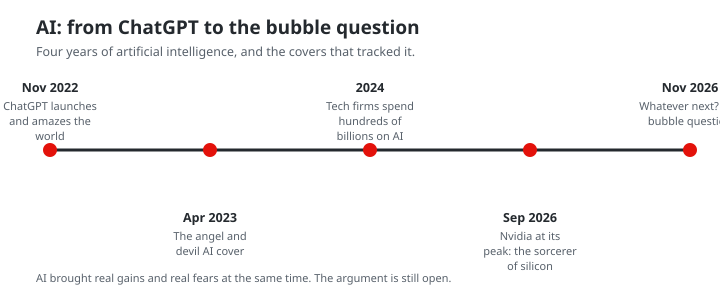

# 2023

[Back to the full index](../README.md)

2023 was the year artificial intelligence broke into daily life. The magazine's AI cover, an angel and a devil in two letters, captured the argument the world is still having.

## At a glance

| Cover | Date | Theme | The call | Status |
|---|---|---|---|---|
| The AI angel and devil cover | April 22, 2023 | Tech and business | AI would be both an angel of progress and a devil of danger | ✅ HAPPENED |
| The World Ahead 2023 | annual preview issue, published November 2022 | Politics and leaders | War, US-China rivalry and inflation would dominate 2023 | 🟡 PARTLY HAPPENED |

---

## The AI angel and devil cover: April 22, 2023

**Cover line:** The cover is dominated by the giant letters "AI". The cover story's theme was "How to worry wisely about artificial intelligence".

**What the cover shows:** Two huge black 3D letters, A and I, stand on a pale blue background. The letter A wears a glowing golden halo, like an angel. The letter I has red devil horns and a red pointed tail curling behind it.

**The picture, piece by piece:**
- The golden halo on the A makes AI the angel: the helper that could cure disease and boost science.
- The red horns and pointed tail on the I make the same AI a devil: danger hiding in the same word.
- Angel and devil are joined in one word: you cannot take the promise without the risk.
- The plain pale background and giant black letters give the cover the feel of a warning sign.

**What was happening:** ChatGPT had launched a few months earlier and amazed the world. Tech firms were racing to build smarter AI, while experts were warning about everything from mass job losses to AI getting out of human control.

**The point it made:** AI could be an angel that cures diseases and boosts science, or a devil that brings real danger. The magazine's advice was to worry wisely: take the risks seriously without panicking.

**Verdict: Came true.** That angel-versus-devil picture still describes the world of 2026. AI spread into work, science and daily life with real gains, while fears about jobs, scams, deepfakes and an AI money bubble also grew, and the same debate continues today.

**What happened next:**
- 2023: AI tools spread into offices, schools and daily life after ChatGPT.
- 2023 and after: warnings grew about job losses, scams and deepfakes.
- 2024 and 2025: tech firms poured huge sums into AI, feeding talk of a money bubble.
- 2026: the angel versus devil argument is still the main AI debate.

*Sources: [Instagram archive post](https://www.instagram.com/p/DJKuc0tRmR0/), [Irving Wladawsky-Berger blog](https://blog.irvingwb.com/blog/2023/05/the-world-changing-potential-of-ai.html?no_prefetch=1)*

---

## "The World Ahead 2023": annual preview issue, published November 2022

**What the cover shows:** A collage of photographic portraits of the leaders who were expected to shape the year: Xi Jinping, Vladimir Putin, Joe Biden, Volodymyr Zelensky, Tsai Ing-wen and Ursula von der Leyen, mixed with images of technology and energy.

**The picture, piece by piece:**
- The leaders' faces are the year's cast list: the people expected to shape 2023.
- Zelensky placed among presidents and prime ministers shows Ukraine's leader now sits at the top table.
- Putin and Xi in the same collage point at the two big challenges facing the West.
- The technology and energy images mixed in say the year would also turn on chips, fuel and power.

**What was happening:** The issue was made while Russia's war in Ukraine raged, inflation was high around the world, and tension between America and China was rising.

**The point it made:** The magazine said 2023 would be dominated by the war in Ukraine, the America-China rivalry, and the aftershocks of COVID and inflation.

**Verdict: Partly true.** Those leaders and those fights did dominate 2023: the war ground on, US-China tension stayed high, and inflation slowly came down. The year's biggest surprise, the explosion of AI after ChatGPT, was bigger than almost anyone forecast.

**What happened next:**
- 2023: Russia's war in Ukraine ground on for a second year.
- 2023: tension between America and China stayed high all year.
- 2023: inflation slowly came down in most rich countries.
- 2023: AI exploded into public life after ChatGPT, the surprise the cover underplayed.

*Source: [Facebook post](https://www.facebook.com/permalink.php?story_fbid=pfbid0sTHS71aojFGLvgLA3bLfUQjc5vhasSdJBGoNDFj1JvXKQ2sFTBJxgqhbP9BBcHyYl&id=61582046099085)*
